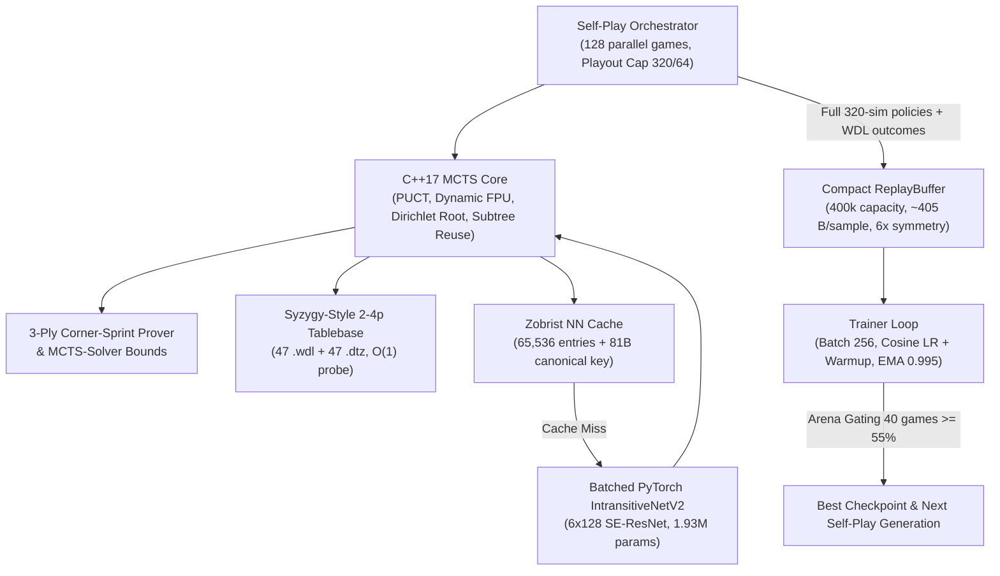

# Intransitive (RPS V6): Comprehensive Technical & Reinforcement Learning Report

**Repository:** `https://github.com/AayanAtGH/RL_Bot_for_Intransitive.git` (`main` @ `6493b02`, 29 tracked files)  
**Engine Version:** v2 (`IntransitiveNetV2` + C++17 Bitboard/MCTS Core + 2–4 Piece Syzygy-Style Tablebase)  
**Verification Baseline:** 31/31 automated unit & integration tests passing (`pytest tests/ -v`, `35.49s`), plus end-to-end local Intel Arc XPU smoke run.

---

## 1. Executive Summary & v1 → v2 Transformation

**Intransitive (RPS V6)** is an asymmetric-cycle two-player abstract strategy game played on a $9 \times 9$ grid where pieces correspond to **Rock (`R`)**, **Paper (`P`)**, and **Scissors (`S`)**. Because piece captures follow an intransitive cyclic dominance relation ($R \succ S \succ P \succ R$) combined with sudden-death goal squares at opposite corners (`i9` and `a1`), the game blends tactical race geometry with dynamic material-composition imbalances that cannot be evaluated by naive material counting.

An audit of the initial Python prototype (documented in [TRAINING_FLAWS_AND_LIMITATIONS.md](file:///c:/Users/Asus/Documents/antigravity/intransitive/TRAINING_FLAWS_AND_LIMITATIONS.md)) identified severe structural, algorithmic, and compute bottlenecks that prevented strong *tabula rasa* reinforcement learning. The v2 architecture resolves those issues end-to-end by pairing a high-throughput C++17 search and bitboard engine with an upgraded Squeeze-and-Excitation Residual Network (`IntransitiveNetV2`), exact 2–4 piece retrograde endgame tablebases, and batched cross-game inference.

| Dimension | v1 Prototype (Legacy) | v2 Engine (Current) | Architectural Impact |
| :--- | :--- | :--- | :--- |
| **Game & MCTS Core** | Pure Python board & tree loop | C++17 bitboard core (`bitboard.hpp`, `board.hpp`, `mcts_core.hpp`) | 2,000+ games/hr batched local throughput; fuzz-verified over 2,000 games (`>10,000` plies) |
| **Search Horizon & Tactics** | 25–40 sims vs. $b \approx 40\text{–}60$ branching factor; 120-ply adjudication | 320/64 Playout Cap sims + 3-ply corner-sprint prover + adaptive `min_pv_depth = 6` + MCTS-Solver | Eliminates shallow tactical blunders and horizon-blind goal races |
| **Tree Efficiency** | No subtree reuse, no TT/cache, naive FPU, no repetition guard | Subtree reuse + Zobrist NN cache (`16,384` / `65,536`) + Dynamic FPU (`0.25` / `0.05`) + 2-fold repetition avoidance | Reuses search work across plies and eliminates duplicate GPU evaluations |
| **Neural Network** | `4×64` ResNet (`1,162,737` params; `841,512` in dense policy FC) + `tanh` scalar head | `6×128` SE-ResNet (`1,927,151` params; `94.6%` in tower + Conv policy + 3-class WDL head) | Redirects ~804k parameters from position-blind policy FC into spatial reasoning |
| **Endgame Precision** | None (relied on noisy rollouts/NN down to 2 pieces) | Full 47-slice 2–4 piece `WDL` + `DTZ` tablebase (`301,329,531` states, `437.54 MB`) | Exact perfect endgame play & terminal value targets upon reaching $\le 4$ pieces |
| **RL Curriculum & Training** | Fixed `START_FEN` openings; naive full-tensor replay | Curriculum starts (`70%` standard, `15%` 1–4 random plies, `15%` 5–8 piece open endgames) + `400k` compact buffer (`~405 B/sample`, `6×` symmetry) + Cosine LR + EMA + Arena gating | Faster coverage of diverse midgames and smooth endgame bridging |



---

## 2. Game Mechanics: Board, Pieces, Action Space & Rules

### 2.1 Board Geometry & Coordinates

The board is a $9 \times 9$ square grid defined in [constants.py](file:///c:/Users/Asus/Documents/antigravity/intransitive/intransitive/core/constants.py):

- `BOARD_SIZE = 9`, `NUM_SQUARES = 81`.
- Squares are indexed linearly `0..80` corresponding to algebraic coordinates `a1` (`0`) through `i9` (`80`).
- **Two Players:** `BLUE = 1` (uppercase `R, P, S` in FEN) and `RED = -1` (lowercase `r, p, s` in FEN).
- **Sudden-Death Goal Squares:**
  - `a1` (`0`, Blue's home square) — `RED_GOAL = 0`; reaching `a1` yields an immediate win for Red.
  - `i9` (`80`, Red's home square) — `BLUE_GOAL = 80`; reaching `i9` yields an immediate win for Blue.

### 2.2 Starting Setup & Piece Triad

The standard initial position is defined by `START_FEN`:

```text
START_FEN = "9/3RP4/2RPS4/1RPS5/1PS3sp1/5spr1/4spr2/4pr3/9 b"
```

Each side begins with **10 pieces** (20 pieces total on the board), identically balanced by type:

- **3 Rocks** (`ROCK = 1`)
- **4 Papers** (`PAPER = 2`)
- **3 Scissors** (`SCISSORS = 3`)

The starting clusters face each other symmetrically across the main axis, leaving both goal squares (`a1` and `i9`) initially empty and reachable through tactical breakthroughs or race maneuvers.

### 2.3 Intransitive Capture Rules & Termination

Captures follow the non-transitive Rock-Paper-Scissors dominance cycle encoded in `BEATS_TYPE = {1: 3, 2: 1, 3: 2}`:

1. **Rock beats Scissors** ($R \succ S$)
2. **Paper beats Rock** ($P \succ R$)
3. **Scissors beats Paper** ($S \succ P$)

Unlike symmetric piece values in Chess, no piece in Intransitive is unconditionally strong or weak: a Paper dominates Rocks yet is completely vulnerable to Scissors. A game terminates when any of the following conditions occurs ([rules.py](file:///c:/Users/Asus/Documents/antigravity/intransitive/intransitive/core/rules.py), [board.py](file:///c:/Users/Asus/Documents/antigravity/intransitive/intransitive/core/board.py)):

1. **Goal Occupation:** A player occupies the opponent's goal corner (`i9` for Blue, `a1` for Red).
2. **Elimination / No Legal Moves:** A side loses all pieces or has zero legal moves on its turn.
3. **Quiet-Move Draw (`QUIET_LIMIT = 200`):** 200 consecutive non-capture plies trigger a draw (preventing infinite circling in theoretical draws).
4. **Search Repetition Handling:** 2-fold repetition avoidance inside MCTS prevents self-play and search trees from cycling in advantageous positions.

### 2.4 Action Encoding & Canonical Symmetries

Every move originates from one of `81` squares and steps into one of `8` clockwise directions (`dir_idx` $\in \{0, \dots, 7\}$), producing a fixed global action space:

$$\text{action} = \text{from\_sq} \times 8 + \text{dir\_idx}, \qquad |\mathcal{A}_{\text{raw}}| = 81 \times 8 = 648$$

Only a legal subset $\mathcal{M}(s) \subset \{0, \dots, 647\}$ (typically $b \approx 40\text{–}60$ in full-board play) is valid in any position $s$. In [canonical.py](file:///c:/Users/Asus/Documents/antigravity/intransitive/intransitive/env/canonical.py), states are always normalized to the **side-to-move's canonical orientation**, so the neural network always evaluates "my pieces vs. opponent pieces" chasing "my target goal corner." Furthermore, because swapping the cyclic piece triad $(R, P, S)$ together with spatial symmetries preserves exact game semantics, the engine exposes a **6-fold (`6×`) symmetry group** (verified end-to-end by `test_native_core.py` and `test_mcts_v2.py`), giving $6\times$ effective sample efficiency in replay sampling without storing 6 copies on disk.

---

## 3. Reinforcement Learning Formalization: Mapping Code to RL Theory

### 3.1 Intransitive as a Canonical Two-Player Markov Game

Although Intransitive is an alternating zero-sum two-player game, canonicalizing board orientation and move perspective allows both players to share a single policy $\pi_\theta(a \mid s)$ and value function $V_\theta(s)$ inside an episodic undiscounted ($\gamma = 1$) Markov Decision Process $\langle \mathcal{S}, \mathcal{A}, \mathcal{P}, \mathcal{R}, \gamma=1 \rangle$:

- **State ($s_t \in \mathcal{S}$):** Encoded as a canonical spatial tensor $X(s_t) \in \mathbb{R}^{11 \times 9 \times 9}$ representing side-to-move piece planes, opponent piece planes, corner/goal indicators, and auxiliary state metadata needed to preserve the Markov property (`quiet_count`, turn normalization).
- **Action Space ($\mathcal{A}$):** Discrete flat space $\mathcal{A} = \{0, \dots, 647\}$ paired with a legal-action mask $\mathcal{M}(s_t) \subseteq \mathcal{A}$.
- **Transition Kernel ($\mathcal{P}$):** Deterministic transition $s_{t+1} = \mathcal{T}(s_t, a_t)$ flipped into the next player's canonical frame, negating the zero-sum frame of reference across plies.
- **Terminal Reward ($\mathcal{R}$):** Sparse terminal outcome $z \in \{-1, 0, +1\}$ from the root/node player's perspective, represented categorically as a one-hot target $y \in \{\text{LOSS } [1,0,0],\; \text{DRAW } [0,1,0],\; \text{WIN } [0,0,1]\}$.

### 3.2 Legal Masking & Probability Distributions

A raw neural network outputs unnormalized logits $z_\theta(s) \in \mathbb{R}^{648}$ matching every `(square, direction)` slot. Because moving off-board, moving an opponent's piece, or illegally overlapping a friendly/beating square is invalid, applying a softmax over all 648 indices would waste probability mass and corrupt gradients.

Instead, the engine applies **strict legal masking** prior to normalization:

$$\tilde{z}_a = \begin{cases} z_{\theta, a}(s) & \text{if } a \in \mathcal{M}(s) \\ -\infty & \text{if } a \notin \mathcal{M}(s) \end{cases}, \qquad p_\theta(a \mid s) = \frac{\exp(\tilde{z}_a)}{\sum_{a' \in \mathcal{M}(s)} \exp(\tilde{z}_{a'})}$$

This guarantees:

1. $\sum_{a \in \mathcal{M}(s)} p_\theta(a \mid s) = 1$ with $p_\theta(a \mid s) = 0$ identically for every illegal action.
2. Clean, exact policy-gradient / cross-entropy credit assignment restricted exclusively to the legal action simplex $\Delta(\mathcal{M}(s))$.

During self-play ([self_play.py](file:///c:/Users/Asus/Documents/antigravity/intransitive/intransitive/rl/self_play.py)), MCTS converts its visit counts $\{N(s_0, a)\}_{a \in \mathcal{M}(s_0)}$ into an improved **empirical policy distribution** $\pi_{\text{MCTS}}(a \mid s_0)$ modulated by temperature $\tau$:

$$\pi_{\text{MCTS}}(a \mid s_0) = \frac{N(s_0, a)^{1/\tau}}{\sum_{b \in \mathcal{M}(s_0)} N(s_0, b)^{1/\tau}}$$

- **Opening exploration (`ply < temp_threshold_ply = 24`):** $\tau = 1.0$ samples proportionally to visit counts, generating diverse opening trajectories across games.
- **Tactical exploitation (`ply >= 24`):** $\tau = 0.15$ sharpens $\pi_{\text{MCTS}}$ onto near-argmax play while retaining soft visit proportions in recorded policy targets.

### 3.3 Generalized Policy Iteration (GPI) & Playout Cap Randomization

The training loop ([trainer.py](file:///c:/Users/Asus/Documents/antigravity/intransitive/intransitive/rl/trainer.py)) executes **Generalized Policy Iteration** via AlphaZero-style self-play without supervised pretraining (*tabula rasa* RL):

1. **Policy Improvement Operator ($\mathcal{T}_{\text{MCTS}}$):** Using the current network $(p_\theta, q_\theta)$, MCTS performs multi-step lookahead (enhanced with exact 3-ply proofs and 2–4 piece tablebase lookups) to produce an improved distribution $\pi_{\text{MCTS}}(\cdot \mid s) \succeq p_\theta(\cdot \mid s)$.
2. **Policy & Value Evaluation / Projection:** Stochastic Gradient Descent trains $(p_\theta, q_\theta)$ toward $(\pi_{\text{MCTS}}, y_{\text{outcome}})$, distilling tree search lookahead back into fast single-pass intuition.

To triple the number of self-play game outcomes observed per GPU compute hour without degrading policy label quality, v2 implements **Playout Cap Randomization** (KataGo-style):

- With probability $p_{\text{full}} = 0.25$: run a **full search** (`full_simulations = 320` base sims, up to `640` under PV depth extension) and record the sample (`state`, $\pi_{\text{MCTS}}$, `value`) as both a **policy + value** training target.
- With probability $1 - p_{\text{full}} = 0.75$: run a **fast search** (`fast_simulations = 64` sims) and use those moves to progress the game quickly toward terminal outcomes (`WDL` / tablebase hits), **masking out policy supervision** on fast plies so noisy 64-sim visit counts never contaminate $p_\theta$.

### 3.4 Loss Function & WDL Value Formalization

Training optimizes a composite multi-task objective over mini-batches of size `256` with `replay_ratio = 1.5`:

$$\mathcal{L}(\theta) = \underbrace{-\sum_{a \in \mathcal{M}(s)} \pi_{\text{MCTS}}(a \mid s) \log p_\theta(a \mid s)}_{\text{Masked Policy Cross-Entropy}} \;+\; \underbrace{\left(-\sum_{k \in \{\text{LOSS}, \text{DRAW}, \text{WIN}\}} y_k \log q_\theta(k \mid s)\right)}_{\text{3-Class WDL Cross-Entropy}} \;+\; c \|\theta\|_2^2$$

From the predicted categorical distribution $q_\theta = (q_{\text{LOSS}}, q_{\text{DRAW}}, q_{\text{WIN}})$, the engine recovers the scalar value fed into MCTS:

$$V_\theta(s) = q_\theta(\text{WIN} \mid s) - q_\theta(\text{LOSS} \mid s) \in [-1, +1]$$

Predicting 3-class WDL probabilities via cross-entropy rather than regressing a single `tanh` scalar via MSE offers two decisive RL advantages:

1. **Non-vanishing gradients near certainty:** Cross-entropy gradients remain well-conditioned when outcomes are decisive, whereas `tanh` saturates (`d/dx tanh(x) -> 0`).
2. **Draw awareness (`q_DRAW`):** Positions with a sharp 50/50 tactical swing (`q = [0.49, 0.02, 0.49]`) look identical in expected value ($V = 0.0$) to dead-drawn symmetric endgames (`q = [0.00, 1.00, 0.00]`), yet have completely different strategic implications; WDL logits preserve that uncertainty explicitly.

---

## 4. Monte Carlo Tree Search, Dirichlet Noise & Search Depth

All tree traversal executes inside C++ ([mcts_core.hpp](file:///c:/Users/Asus/Documents/antigravity/intransitive/cpp/mcts_core.hpp)) wrapped by Python orchestration ([mcts.py](file:///c:/Users/Asus/Documents/antigravity/intransitive/intransitive/rl/mcts.py)).

### 4.1 PUCT Selection & Dynamic First Play Urgency (FPU)

At every internal node $s$, MCTS selects the legal child $a \in \mathcal{M}(s)$ maximizing the PUCT score:

$$a^* = \arg\max_{a \in \mathcal{M}(s)} \left[ Q_{\text{eff}}(s, a) + c_{\text{puct}} \cdot P(s, a) \cdot \frac{\sqrt{\sum_{b} N(s, b)}}{1 + N(s, a)} \right], \qquad c_{\text{puct}} = 1.5$$

For unvisited children ($N(s, a) = 0$), v1 assigned a naive constant value (often causing MCTS either to exhaustively sample weak unvisited moves at high-value nodes or ignore promising lines when the parent was slightly negative). v2 fixes this with **Dynamic FPU Reduction**:

$$Q_{\text{unvisited}}(s) = V(s) - c_{\text{fpu}} \sqrt{\sum_{b:\, N(s,b) > 0} P(s, b)}$$

- Internal nodes use `fpu_reduction = 0.25`: unvisited moves are penalized proportionally to how much prior probability mass has *already* been explored, automatically shifting from broad exploration (early visits) to sharp exploitation (late visits).
- The root node uses a gentler `root_fpu_reduction = 0.05` so Dirichlet-boosted candidate moves at the root can still receive exploratory visits rather than being suppressed by FPU.

### 4.2 Root Dirichlet Noise: Mechanism & RL Intuition

To guarantee persistent exploration in a deterministic game during *tabula rasa* self-play, the root prior $P(s_0, \cdot)$ is perturbed with Dirichlet noise:

$$P'(s_0, a) = (1 - \varepsilon) P(s_0, a) + \varepsilon \eta_a, \qquad \eta \sim \text{Dir}(\alpha, \dots, \alpha)$$

with default hyperparameters `dirichlet_alpha = 0.3` and `dirichlet_eps = 0.25`.

**Intuition & Parameter Calibration:**

- **Why $\alpha = 0.3$?** The concentration parameter $\alpha$ follows the AlphaZero scaling heuristic $\alpha \approx 10 / \bar{b}_{\text{effective}}$. With Intransitive's typical midgame branching factor of $40\text{–}60$ (smaller in endgames), $\alpha = 0.3$ creates a **sparse, spiky noise vector** rather than flat uniform noise (which would require $\alpha \ge 1.0$). In each game, a few unexpected legal moves at the root receive meaningful exploratory weight while terrible moves remain mostly ignored.
- **Why only at the root?** Adding Dirichlet noise inside deeper tree nodes would corrupt MCTS backup values $Q(s, a)$ with artificial randomness, hiding genuine tactical refutations. Keeping noise strictly at $s_0$ forces the search to *honestly evaluate* whether an unusual opening idea holds up under sharp refutation play.

### 4.3 Guaranteeing Tactical Depth Before Leaf Evaluation

In an earlier v1 bottleneck, $25\text{–}40$ simulations across a $40\text{–}60$ branching factor barely expanded depth $1\text{–}2$, meaning the network was forced to guess purely from static board evaluations without seeing simple 2–3 ply capture combinations or goal races. Engine v2 enforces meaningful lookahead before relying on neural leaf values via four mechanisms:

1. **Exact 3-Ply Corner-Sprint Tactical Prover ([tactical_prover.hpp](file:///c:/Users/Asus/Documents/antigravity/intransitive/cpp/tactical_prover.hpp)):** Before calling the neural network at leaf or root expansion, a fast deterministic C++ prover checks immediate 1-ply goal captures/threats and 2–3 ply forced goal-sprint wins or defenses. Forced wins/losses are resolved instantaneously with exact $\pm 1$ bounds instead of wasting NN capacity.
2. **MCTS-Solver Exact Backpropagation:** When a leaf is solved exactly (by game rules, 3-ply prover, or the 2–4 piece tablebase), its `proven` state propagates up the tree: *one* proven child win proves the parent a loss for the side that walked into it (win for mover), while *all* children proven lost prove a node lost. Once proven, nodes lock their exact value rather than drifting with sample averages.
3. **Adaptive `min_pv_depth = 6` Extension:** At the root, if the Principal Variation (most-visited path) has depth $< 6$ when `num_simulations` finishes, the C++ MCTS loop automatically extends search budgets up to `max_simulations = 2 * num_simulations` until either a 6-ply PV is reached or the search tree reaches a terminal/tablebase leaf.
4. **Subtree Reuse & 2-Fold Repetition Avoidance:** Instead of throwing away the entire search tree after every move, the child corresponding to the played action becomes the next root, immediately seeding the subsequent ply with depth $5\text{–}10+$ already searched; simultaneously, 2-fold cycle guards avoid fruitless perpetual-check-style repetitions when playing for a win.

---

## 5. Leaf Evaluator Neural Network Architecture (`IntransitiveNetV2` vs. `V1`)

Implemented in [network.py](file:///c:/Users/Asus/Documents/antigravity/intransitive/intransitive/rl/network.py), the neural network balances two competing constraints: **expressive spatial & cycle reasoning** vs. **sample-efficient gradient flow** within a 100–200 Colab Compute Unit budget.

### 5.1 Why 6 Residual Blocks × 128 Channels with Squeeze-and-Excitation?

- **Too Shallow (e.g., 2–4 × 64):** Insufficient receptive field to track diagonal goal threats across the $9 \times 9$ grid simultaneously with multi-piece Rock-Paper-Scissors interaction chains, causing persistent tactical blind spots.
- **Too Deep (e.g., 15–20 × 256):** With $5\text{–}15\times$ more parameters and FLOPs per simulation, self-play throughput drops sharply under a fixed CU budget, risking under-trained towers and slow policy convergence in *tabula rasa* RL.
- **The 6 × 128 SE-ResNet Sweet Spot:** Six $3 \times 3$ residual blocks (two convolutions per block = 12 convolutional layers after the stem) already span a wide $9 \times 9$ receptive field cleanly. Adding **Squeeze-and-Excitation (SE)** blocks every 2 residual blocks (`se_every = 2`) provides global board-wide channel recalibration (weighting whether the current phase requires aggressive Rock push vs. corner sprint defense) for minimal FLOP overhead, while **zero-initializing `bn2.weight`** in every residual block ensures the network initializes close to identity mapping for smooth gradient propagation from iteration 1.

### 5.2 Exact Parameter Comparison: `IntransitiveNetV1` vs. `IntransitiveNetV2`

Direct inspection of the instantiated PyTorch modules reveals a dramatic structural reallocation of parameters:

| Module Component | `IntransitiveNetV1` (`4×64`) | Params (V1) | Share (V1) | `IntransitiveNetV2` (`6×128` + SE) | Params (V2) | Share (V2) |
| :--- | :--- | ---: | ---: | :--- | ---: | ---: |
| **Input Stem** | `11 → 64` (3×3 Conv + BN) | `4,160` | `0.36%` | `11 → 128` (3×3 Conv + BN) | `12,928` | `0.67%` |
| **Residual Tower** | 4 plain ResBlocks (`64ch`) | `295,936` | `25.45%` | 6 ResBlocks (`128ch`, `se_every=2`, zero-init `bn2`) | `1,822,560` | `94.57%` |
| **Policy Head** | `policy_conv` (`1,024`) + `bn` (`32`) + `fc` (`840,456`) | `841,512` | **`72.37%`** | `policy_conv1` (`128→32` 3×3: `36,864`) + `bn1` (`64`) + `conv2` (`32→8` 1×1: `264`) | `37,192` | `1.93%` |
| **Value Head** | `value_conv` (`256`) + `bn` (`8`) + `fc1` (`20,800`) + `fc2` (`65`, scalar `tanh`) | `21,129` | `1.82%` | `value_conv` (`4,096`) + `bn` (`64`) + `spatial` (`132`) + `fc1` (`388→128`: `49,792`) + `fc2` (`387`, 3-class WDL) | `54,471` | `2.83%` |
| **Total Parameters** | — | **`1,162,737`** | **`100%`** | — | **`1,927,151`** | **`100%`** |

Two key architectural insights explain v2's superiority:

1. **Convolutional Policy Head (`permute(0, 2, 3, 1) → 648`):** In v1, flattening features through a massive dense linear layer consumed **72.37%** (`840,456` parameters) of the entire network just to memorize `(from_sq, dir_idx)` mappings without spatial weight sharing. By replacing it with a purely convolutional `128 → 32 (3×3) → 8 (1×1)` head aligned directly with `(row, col, dir_idx)`, v2 achieves translation equivariance across all 81 squares while shrinking the policy head by **95.6%** (`841,512 → 37,192`) and investing **94.57%** of total parameters (`1,822,560`) directly into the reasoning backbone.
2. **Multi-Scale Global + Spatial Value Head (`388 → 128 → 3`):** Instead of collapsing the board rigidly through a single low-channel convolution, v2 concatenates global average pooling, global max pooling (detecting isolated tactical threats or winning pieces anywhere on the board), and spatial position features (`4 × 81`) before predicting 3 WDL logits `[LOSS=0, DRAW=1, WIN=2]`. Legacy v1 checkpoints remain seamlessly loadable via automatic architecture detection in [network.py](file:///c:/Users/Asus/Documents/antigravity/intransitive/intransitive/rl/network.py).

---

## 6. 2–4 Piece Syzygy-Style Endgame Tablebase (`WDL` + `DTZ`)

### 6.1 Why Raw `(position, outcome, distance_to_win)` Tuples Fail

Storing uncompressed `(position, outcome, distance_to_win)` tuples naively fails on two fronts:

1. **Storage & Memory Explosion:** The full 2–4 piece canonical state space contains **301,329,531 positions**. Storing even a 64-byte hash-table tuple per position would consume **~19–30 GB** of RAM, defeating fast GPU co-residency and distribution.
2. **Broken Greedy `DTM - 1` Move Rule Under Conversions:** In games with captures, promotions, or quiet-move draw counters (`QUIET_LIMIT = 200`), a move does not merely step `DTM - 1` within the same slice—it can capture a piece, transitioning cleanly into a smaller $N-1$ piece sub-tablebase and resetting the quiet counter!

Inspired by Chess **Syzygy** tablebases, our C++ retrograde generator ([tb_gen.cpp](file:///c:/Users/Asus/Documents/antigravity/intransitive/cpp/tb_gen.cpp), [tb_index.hpp](file:///c:/Users/Asus/Documents/antigravity/intransitive/cpp/tb_index.hpp), [tb_probe.hpp](file:///c:/Users/Asus/Documents/antigravity/intransitive/cpp/tb_probe.hpp), Python interface [tablebase.py](file:///c:/Users/Asus/Documents/antigravity/intransitive/intransitive/core/tablebase.py)) partitions states by exact **material signature slice** (e.g., `PS_vs_rs`), canonicalizes board symmetries into dense combinatorial indices, and stores two compact flat arrays per slice:

- **`.wdl` (2 bits/state):** Game-theoretic value `{UNKNOWN/ILLEGAL, LOSS, DRAW, WIN}`.
- **`.dtz` (8 bits/state):** **Distance to Zeroing** — minimum plies to either reach the goal corner or execute a capture (zeroing the 200-ply quiet counter and transitioning into an already-solved smaller tablebase).

### 6.2 Exact Combinatorial Scaling ($N = 2$ through $N = 6$)

| Piece Count $N$ | Material Slices | Exact Canonical States | Packed Size (`1.25 B/state`) | Measured Generation Time | Feasibility |
| :---: | ---: | ---: | ---: | ---: | :--- |
| **$N = 2$** | 3 tables | `9,567` | `~11.7 KiB` | `0.054s` | Instant |
| **$N = 3$** | 12 tables | `2,220,606` | `~2.65 MiB` | `~3.53s` | Seconds |
| **$N = 4$** | 32 tables | `299,099,358` | `437.54 MB` (disk) | `539.178s` (8 threads, $N \le 4$) | **Practical exact boundary** |
| **$N = 5$** | 70 tables | `29,234,320,416` | `~36.54 GB` (est.) | Hours + high RAM/disk | Infeasible for Colab/local |
| **$N = 6$** | 130 tables | `2,333,403,873,108` | `~2.92 TB` (est.) | Prohibitive | Intractable |

With `1.25 bytes` per canonical state (`2 bits WDL + 8 bits DTZ`), stopping at **$N \le 4$** produces **94 binary files** (`47 .wdl` totaling `87.51 MB` + `47 .dtz` totaling `350.04 MB` = **`437.54 MB`** total on disk), easily fitting into system RAM alongside PyTorch and MCTS, whereas $N = 5$ blows up nearly **$98\times$** overnight.

### 6.3 Observed Retrograde Statistics & Intransitive Domain Insights

The C++ generator's exact retrograde pass revealed striking tactical properties of Intransitive endgames:

| Slice | Valid States | Wins (`W`) | Draws (`D`) | Losses (`L`) | Max DTZ | Key Strategic Takeaway |
| :--- | ---: | ---: | ---: | ---: | ---: | :--- |
| `S_vs_s` | `3,189` | `1,836` (`57.6%`) | `0` (`0.0%`) | `1,353` (`42.4%`) | `23` | First-mover race tempo decides symmetric 1v1 |
| `S_vs_p` | `3,189` | `2,528` (`79.3%`) | `0` (`0.0%`) | `661` (`20.7%`) | `15` | Dominant type wins almost 4 out of 5 positions |
| `S_vs_r` | `3,189` | `1,007` (`31.6%`) | `0` (`0.0%`) | `2,182` (`68.4%`) | `16` | Subordinate piece still wins 31.6% via corner-sprint tempo |
| `S_vs_pp` | `123,511` | `73,263` | `7,899` | `42,349` | `17` | Even 1v2, matching type superiority (`S ≻ P`) dominates |
| `SS_vs_ss` | `9,495,642` | `3,761,383` | `3,289,289` (`34.6%`) | `2,444,970` | `23` | Symmetric equal-type endgames create heavy fortress draws |
| `PS_vs_ps` | `18,992,208` | `9,831,013` | `2,729,052` (`14.4%`) | `6,432,143` | `45` | Mixed pairs unlock tactical encirclement |
| `PS_vs_rs` | `18,992,208` | `9,045,402` | `5,037` (`0.027%`) | `9,941,769` | `50` | Asymmetric material virtually eliminates draws |
| `PS_vs_rp` | `18,992,208` | `13,230,406` | `3,297` (`0.017%`) | `5,758,505` | `49` | Sharp type advantage yields crisp, decisive conversions |

Crucially, across all **47 slices**, **`cursed = 0` and `blessed = 0`**: every theoretically winning 2–4 piece line converts within at most `maxDTZ = 50` quiet plies—far below `QUIET_LIMIT = 200`—meaning no winning 4-piece endgame is ever thwarted by the quiet-move draw rule. Probing runs in $O(1)$ during MCTS leaf evaluation (supplying exact terminal WDL bounds) and at root play (selecting minimum-DTZ winning moves / captures or maximum-DTZ defensive resistance).

---

## 7. Compute, Memory & Systems Optimizations

To maximize training iterations per Compute Unit without sacrificing search quality, v2 incorporates five systems-level optimizations:

1. **C++17 Bitboard & Rules Engine ([bitboard.hpp](file:///c:/Users/Asus/Documents/antigravity/intransitive/cpp/bitboard.hpp), [board.hpp](file:///c:/Users/Asus/Documents/antigravity/intransitive/cpp/board.hpp), [c_api.cpp](file:///c:/Users/Asus/Documents/antigravity/intransitive/cpp/c_api.cpp)):** Bitboards pack piece placements into 64-bit registers (`uint64_t` pairs covering 81 bits) with pre-computed direction masks, eliminating Python object allocations inside MCTS.
2. **Cross-Game Batched Inference (`num_parallel_games = 128`, `selfplay_batch_size = 256`):** Rather than running MCTS game-by-game with batch size `1`, the C++ orchestrator runs 128 concurrent games, yields all leaf states waiting for evaluation simultaneously, and executes a single vectorized GPU/XPU forward pass of up to 256 states—boosting local throughput past **3,200 NN evals/sec** even on laptop integrated XPU.
3. **Zobrist + Canonical 81-Byte NN Cache (`16,384` single / `65,536` batched):** Transpositions across move orders in the MCTS tree resolve directly from an in-memory cache verified against full 81-byte canonical keys to prevent Zobrist hash collisions, saving substantial GPU inference work.
4. **Compact Replay Buffer (`400,000` capacity at `~405 B/sample`):** Storing raw float32 `(11, 9, 9)` tensors plus dense 648-float policies for 400k positions would demand `>2 GB` RAM. By storing compact packed board representations + sparse policy indices/weights (`~162 MB` total for 400k samples) and materializing `(11, 9, 9)` tensors + random `6×` symmetries lazily during mini-batch sampling ([replay_buffer.py](file:///c:/Users/Asus/Documents/antigravity/intransitive/intransitive/rl/replay_buffer.py)), both RAM and disk `.npz` serialization stay compact.
5. **Optimization & Regularization Schedule ([trainer.py](file:///c:/Users/Asus/Documents/antigravity/intransitive/intransitive/rl/trainer.py)):** Cosine Learning Rate Decay (`1e-3 → 1e-4`) with a linear `warmup_steps = 200` prevents early destabilization from uninitialized value heads; **Exponential Moving Average (`ema_decay = 0.995`)** stabilizes self-play teacher weights; and **Automatic Mixed Precision (`AMP`)** accelerates CUDA tensor-core execution on cloud GPUs.

---

## 8. Verification Results & Smoke Benchmarks

### 8.1 Automated Test Suite (`31 / 31` Passing)

Running `pytest tests/ -v` executed in **`35.49s`** with **`31 passed, 2 warnings`** across all six test modules:

| Test File | Cases | Scope Verified |
| :--- | :---: | :--- |
| `test_fen.py` | 4 | FEN serialization/deserialization, board coordinate roundtrips, invalid-input guards |
| `test_rules.py` | 7 | Legal move generation, Rock/Paper/Scissors capture resolution, corner goals (`a1`/`i9`), quiet limit draws |
| `test_mcts.py` | 7 | Core MCTS policy masking, PUCT visit prioritization, Dirichlet noise injection, terminal detection |
| `test_native_core.py` | 3 | C++ DLL binding load, **2,000-game C++ vs. Python rule equivalence fuzz (`>10,000` plies)**, **6× symmetry invariance** |
| `test_tablebase.py` | 2 | **113,778-state exhaustive 2-piece cross-check** against independent Python solver + **500 2–4 piece TB-vs-TB games** verifying DTZ progress |
| `test_mcts_v2.py` | 8 | 3-ply corner-sprint prover, 2-ply threat defense, Dynamic FPU + subtree reuse + adaptive PV depth (`>= 6`), 2-fold repetition avoidance, `IntransitiveNetV2` & legacy v1 loader, compact `ReplayBuffer` 6× & `.npz` roundtrip, 16-game C++ batched self-play |

### 8.2 Local Intel Arc XPU Smoke Run

To verify full integration (C++ MCTS + 4-piece TB + `IntransitiveNetV2` + Playout Cap + ReplayBuffer + Trainer + Checkpoint save/reload) prior to cloud training, a 2-iteration smoke test ran on local Intel Arc XPU (`AMP=False`, `--parallel-games 32 --sp-batch 64 --full-sims 64 --fast-sims 16 --samples-per-iter 512 --batch-size 64`):

- **Runtime Setup:** `Device: xpu | AMP=False | TB=Loaded (max 4p) | Network: 6x128 SE-ResNet (1,927,151 params)`
- **Iteration 1:** `G/hr=715 | NN/s=3238 | PVd=3 | TBterm=0 | Plies=62.4 | Buf=562 | Pol=6.399 WDL=0.937 Acc=50.0% | LR=0.00010`
- **Iteration 2:** `G/hr=2181 | NN/s=3237 | PVd=3 | TBterm=0 | Plies=190.3 | Buf=1133 | Pol=6.180 WDL=1.236 Acc=32.9% | LR=0.00016`
- **Checkpoint Integrity:** Reloaded saved checkpoint cleanly with exact architecture metadata `{'in_channels': 11, 'hidden_channels': 128, 'num_res_blocks': 6, 'se_every': 2}`, `1,927,151` parameters, confirming end-to-end persistence.

---

## 9. Google Colab Training Plan & Antigravity MCP Workflow

### 9.1 Compute Budget & Training Curriculum

With CUDA T4 GPUs and `AMP=True`, default trainer settings (`num_parallel_games = 128`, `selfplay_batch_size = 256`, Playout Cap `320/64` at `p = 0.25`, `temp_threshold_ply = 24`, `batch_size = 256`, `replay_ratio = 1.5`) stretch Google Colab Compute Units (CUs) efficiently:

- **100 CU Budget:** Yields roughly **50–65 hours** on T4 GPUs, corresponding to **~80,000–200,000 self-play games**—sufficient for clean opening/midgame tactical competence, multi-piece RPS trapping, and seamless conversion into 4-piece tablebase wins.
- **200 CU Budget:** Yields roughly **100–130 hours** (~**160,000–400,000 games**), driving deeper positional evaluation and robust 40-game Arena Gating promotion cycles (`thresh = 0.55`).

Rather than playing every game purely from `START_FEN`, self-play uses a **3-tier curriculum initialization**:

- **70% Standard Openings (`START_FEN`):** Master full-board mainlines and opening theory.
- **15% Randomized 1–4 Ply Starts:** Force structural novelty and avoid narrow deterministic opening traps.
- **15% 5–8 Piece Open Endgames:** Directly bridge midgame search directly into the 4-piece tablebase boundary, giving the value head dense ground-truth supervision across the transition zone.

### 9.2 Cloud Runner & Antigravity Colab MCP Setup

Two dedicated entry points ([scripts/colab_train.py](file:///c:/Users/Asus/Documents/antigravity/intransitive/scripts/colab_train.py) and [notebooks/train_colab.ipynb](file:///c:/Users/Asus/Documents/antigravity/intransitive/notebooks/train_colab.ipynb)) handle cloning, compiling the C++ DLL via `scripts/build_cpp.py`, building/mounting the 4-piece tablebase, and syncing checkpoints safely to Google Drive every iteration so Colab session preemption never loses progress.

To let Antigravity inspect notebooks, launch training runs, monitor `G/hr` / `NN/s` / `TBterm` / Arena promotion telemetry, and iterate directly on a Colab runtime, connect Google's official **`colab-mcp`** server (`googlecolab/colab-mcp` via `uvx git+https://github.com/googlecolab/colab-mcp`, or the hosted MCP endpoint `https://colaboratory.googleapis.com/mcp`), authorize Google OAuth/Drive access, and execute `notebooks/train_colab.ipynb` interactively.

---

## 10. Intuition-Based Technical Q&A & Design Rationale

### Q1: Why not skip the Neural Network and just use Pure MCTS + 4-Piece Endgame Tablebase?

Even with perfect knowledge at $\le 4$ pieces, a standard starting position has **20 pieces** and a branching factor of **$b \approx 40\text{–}60$**. Pure MCTS (UCT with uniform priors and random Monte Carlo rollouts) suffers from three fatal limitations here:

1. **The 20-Piece-to-4-Piece Horizon Gap:** Pure random rollouts from 20 pieces drift blindly through noise for tens of plies before ever stumbling into a 4-piece state, producing extremely high-variance value estimates that fail to signal which 10-piece exchanges actually lead to winning 4-piece endgames.
2. **Tactical Trap Sensitivity:** In Rock-Paper-Scissors, a single square mistake turns a winning attacker into free capture bait. Without a learned policy prior $P(s, a)$ pruning hopeless moves immediately, $95\%+$ of UCT rollouts waste compute on blundered captures and blind diagonal pushes.
3. **Dense Strategic Credit Assignment:** `IntransitiveNetV2` compresses hundreds of thousands of self-play outcomes and tablebase conversions into fast single-pass intuition, letting MCTS expand the **top 3–5 candidate plans** deeply instead of spreading 320 simulations across 50 mediocre moves.

### Q2: Why store compact WDL + DTZ bit-packed tables instead of raw `(position, outcome, distance_to_win)` tuples?

Beyond cutting storage by **~40–70×** (`437.54 MB` on disk for `301.3M` states instead of tens of gigabytes of hash tuples), naive `DTM - 1` rule lookup fails structurally whenever captures occur. Under Syzygy-style `WDL + DTZ`:

- Inside a single piece-count/material slice, optimal non-converting play strictly decreases `DTZ` on wins (and maximizes `DTZ` on losses).
- Whenever a move **captures** a piece (a zeroing move), control jumps cleanly to the exact smaller $N-1$ piece tablebase where `WDL` tells us instantly whether that conversion wins—eliminating any ambiguity from quiet-move horizon counters.

### Q3: Why enforce tactical search depth (`min_pv_depth = 6` + 3-ply prover) before trusting NN leaf evaluations?

Neural networks are smooth statistical approximators: while adept at judging overall spatial harmony and RPS balance, even strong ResNets occasionally hallucinate on crisp 2–3 ply tactical motifs (an unguarded `i9`/`a1` sprint or an immediate fork between two piece types). Forcing MCTS through a **3-ply exact corner-sprint prover** plus an adaptive **`min_pv_depth = 6`** extension guarantees that obvious tactical lines are resolved analytically before the leaf evaluator scores the resulting quiescent frontier—simultaneously preventing bad tactical labels from polluting the replay buffer during early *tabula rasa* training.

### Q4: Why choose *Tabula Rasa* RL (zero supervised warm-start) over supervised pretraining?

Because Intransitive is a novel asymmetric-cycle domain with no grandmaster human corpus, any handcrafted heuristic dataset used for supervised warm-starting would bake human misconceptions into early network weights (for example, overvaluing raw piece count while undervaluing RPS composition synergy or intentional piece sacrifices to unlock goal races). Starting *tabula rasa*, anchored at both ends by **exact game rules / 3-ply proofs** and the **exact 4-piece Syzygy tablebase**, allows self-play GPI to discover superhuman RPS positional concepts organically without bias.

### Q5: Why 6 Residual Blocks × 128 Channels with SE blocks instead of a smaller 2–4×64 network or a 20×256 giant?

Architecture choice is governed by **strength gained per Colab Compute Unit**:

- v1's `4×64` network suffered not just from fewer blocks, but from squandering `841,512` of its `1.16M` parameters (`72.4%`) on a dense policy FC layer—leaving only `296k` weights (`25.5%`) for actual board understanding.
- Moving to `6×128` + SE with a convolutional policy head puts **`1,822,560` parameters (`94.6%`)** into spatial feature extraction (`~6.2×` the reasoning capacity of v1!) while keeping total parameters at `1.93M` so self-play + SGD advances rapidly through dozens of generations within 100–200 CUs.

### Q6: What does `cursed = 0, blessed = 0` in the 4-piece tablebase tell us about the game's rules?

In Chess under the 50-move draw rule, certain theoretical endgames are "cursed wins" or "blessed losses" (forced wins taking $>100$ plies without captures/pawn moves, resulting in draws). Across all **47 generated 2–4 piece tables (`301,329,531` states)** in Intransitive, the longest forced conversion without capture or goal victory was **`maxDTZ = 50` plies** (`PS_vs_rs`), meaning **`cursed = 0` and `blessed = 0`**. Every single theoretical 2–4 piece win is 100% convertible far ahead of `QUIET_LIMIT = 200`—validating both the balance of `QUIET_LIMIT = 200` and the reliability of our 2–4 piece WDL targets as clean ground truth for RL.
