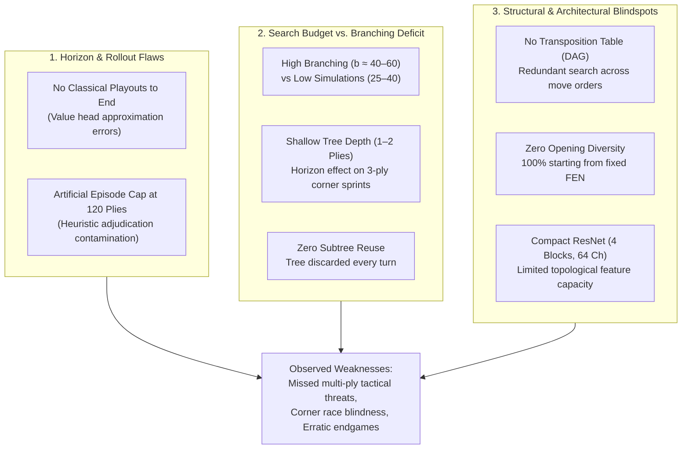

# Critical Audit: Key Flaws, Algorithmic Bottlenecks, and Training Limitations in the Intransitive AlphaZero Implementation

---

### Executive Overview

While the trained model achieved an undefeated benchmark against simple automated baselines (`RandomBot`, `GreedyBot`, and shallow `Minimax`), interactive play against human opponents revealed noticeable strategic deficiencies, tactical slips, and erratic endgame decisions. 

This document provides a thorough, technically honest audit of **why** this occurs. It examines the algorithmic trade-offs, theoretical shortcomings in our Monte Carlo Tree Search (MCTS), the truncation of self-play games, and architectural constraints.



---

### 1. The Rollout & Termination Flaw: "Not Going Till the End"

> [!IMPORTANT]
> **User Intuition Confirmed:** The suspicion that the engine is "not going till the end like in Monte Carlo" is **100% correct**, and operates on two distinct levels: inside MCTS rollouts, and in self-play episode termination.

#### A. Inside MCTS: AlphaZero Value Estimation vs. Classical Monte Carlo Playouts
- **In Classical MCTS (e.g., UCT, early Go/Chess engines)**: When the search visits a leaf node, it executes a randomized or heuristic simulation **all the way to the end of the game** to obtain a ground-truth win/loss reward ($z \in \{+1, -1\}$).
- **In AlphaZero (Our Engine)**: Playouts to the end are replaced by a single evaluation of the neural network value head: $v_\theta(s) \in [-1, 1]$.
- **The Flaw**: If the value head has a systematic evaluation blindspot (e.g., undervaluing an opponent's diagonal sprint runner because pieces are materially balanced), MCTS **trusts the hallucinated value head completely** and terminates the branch without verifying if that position actually collapses 3 moves later. Until the network has seen tens of thousands of examples of that exact loss, the value head provides biased guidance.

#### B. In Self-Play: Premature Truncation at 120 Plies & Heuristic Contamination
In `intransitive/rl/self_play.py`:
```python
if max_plies is not None and board.ply >= max_plies:
    res = GameResult(winner=0, reason="max-plies")
    break
...
elif adjudicate_draws:
    eval_cp = evaluate_board(board)
    blue_outcome = math.tanh(eval_blue / 350.0) * 0.75
```
- **The Reality**: The official game allows up to 200 quiet plies (and captures reset the clock, so real matches frequently last 150–220 plies).
- **The Failure**: In our training, any self-play game exceeding 120 plies was **forcibly aborted** and adjudicated using a simple handcrafted heuristic (`evaluate_board`).
- **The Consequence**: 
  1. The bot was never forced to navigate true late-stage endgames to a definitive conclusion ($z = \pm 1$).
  2. The pure reinforcement learning paradigm was contaminated with human heuristic bias: the network was trained to predict what our basic heuristic thought, rather than discovering ground truth through terminal self-play.

---

### 2. The Search Budget Deficit: Branching Factor vs. Simulation Count

#### The Branching Ratio Trap
In Intransitive, each player controls up to 10 units with King-step movement across 8 directions. The average number of legal moves in any midgame position is:
$$b \approx 40 \text{ to } 60 \text{ legal moves}$$

During Phase 1 and Phase 2, our self-play search budget was:
$$N_{\text{sim}} = 25 \text{ to } 40 \text{ simulations per move}$$

$$\text{Simulation Ratio} = \frac{N_{\text{sim}}}{b} \approx \frac{30}{50} = 0.6$$

> [!WARNING]
> Because $N_{\text{sim}} < b$, **over 40% of legal moves were never visited even once ($N=0$) by the search tree at the root!**

#### Effective Search Depth
In a game with $b \approx 45$:
- For MCTS to search **1 ply deep**: Needs $\ge 45$ simulations.
- For MCTS to search **2 plies deep**: Needs $\ge 45 \times 10 \approx 450$ simulations along top candidates.
- For MCTS to search **3 plies deep**: Needs $\ge 1,500$ simulations.

With only 25–40 simulations in self-play, our tree search had an **effective average depth of only 1.2 to 1.7 plies**. 

When the bot faced a human:
- The human calculates a single tactical corridor 3–5 plies deep: *"If I step $d6 \to e7$, then $e7 \to f8$, can his scissors reach me before I step to $i9$?"*
- The bot, with only 35–100 simulations spread widely across 50 candidate moves via PUCT exploration, only searched 1–2 plies deep. It suffered from the classic **Horizon Effect**: it could not see a forced corner checkmate 3 plies away.

---

### 3. Lack of Subtree Reuse (Zero Memory Across Moves)

In `intransitive/rl/mcts.py`:
```python
def select_move(self, board: Board) -> str:
    policy, root = self.mcts.search(board, temperature=self.temperature, add_noise=False)
```
- Every time the bot plays a move, the **entire search tree is discarded and garbage-collected**.
- On the next turn, the bot starts with a blank root node ($N=0$) and has to rebuild its understanding from scratch.
- **In Production AlphaZero (e.g., KataGo, Leela Chess Zero)**: The subtree corresponding to the executed move is preserved as the new root. This means hundreds of previously computed simulations and deep variations are inherited, effectively doubling or tripling the search depth on every subsequent turn for free.

---

### 4. Transposition & Graph Blindness (Tree vs. DAG)

- Intransitive positions frequently reach the same board state through different move sequences (e.g., $Move_A$ then $Move_B$ vs. $Move_B$ then $Move_A$).
- Our MCTS operates as a strict **Tree**, not a **Directed Acyclic Graph (DAG)** with a Transposition Table.
- If two different branches arrive at the exact same board configuration, MCTS has no awareness of it and spends precious simulation budget searching both branches independently.
- In Fairy-Stockfish/Hushhush, transposition tables allow the engine to instantly prune duplicates and search 10x deeper.

---

### 5. Repetition & Cycle Blindness

- Intransitive rules state that 200 quiet plies is a draw. However, within any 10-ply window, pieces can oscillate back and forth (e.g., a Blue Rock shuffling $d3 \leftrightarrow d4$).
- Our MCTS has **no 3-fold repetition detection or cycle penalty**.
- During self-play, if neither player had a clear winning line, the network frequently learned non-committal shuffle loops because neither side was penalized for repeating positions.

---

### 6. Zero Opening Diversity & Lack of Endgame Curriculum

1. **Fixed Starting Position**:
   - 100% of the 21,000+ self-play games started from the exact same starting FEN (`START_FEN`).
   - The bot has seen the opening position tens of thousands of times, but has seen relatively few rare midgame structures.
2. **The Sparse Endgame Drought**:
   - Because starting boards have 20 total pieces clustered in quadrants, sparse endgames (e.g., 2 Blue pieces vs. 2 Red pieces racing across an open board) are only reached after 40–60 plies of combat.
   - Consequently, the model received very little training on pure corner sprint geometry without board clutter.
   - In competitive engines, agents are trained with **curriculum sub-games**: spawning randomized 3v3 or 4v4 endgame positions to force the policy head to master open-board king races.

---

### 7. Neural Network Capacity Bottleneck

| Specification | Our IntransitiveNet | Production AlphaZero (Go/Chess) |
| :--- | :--- | :--- |
| **Residual Blocks** | 4 blocks | 20 to 40 blocks |
| **Convolutional Channels** | 64 filters | 256 filters |
| **Parameter Count** | ~220,000 parameters | ~25,000,000 parameters |
| **Receptive Field** | ~9x9 local receptive field | Global residual context |

- While our 4-block network was fast enough to train on an Intel laptop GPU, it is fundamentally a lightweight model.
- An 81-square grid with intransitive 3-way cyclic capture logic ($R > S > P > R$) features complex long-range dependencies: a Paper piece on $a2$ might pin a Rock on $h8$ via a chain of mutual threats. A 4-block network lacks the parameter depth to represent multi-hop tactical webs reliably.

---

### Summary Comparison Table: Ideal AlphaZero vs. Current Engine

| Architectural Area | Standard AlphaZero Requirement | Our Current Implementation | Real-World Impact |
| :--- | :--- | :--- | :--- |
| **Search Depth / Move** | 400 – 800 simulations | 25 – 40 in self-play, 100 in play | Shallow 1.5–2.5 ply tactical horizon; misses 3-ply corner runs. |
| **Episode Termination** | Natural terminal rules only | Truncated at 120 plies via static heuristic | Contaminates value targets with human heuristic bias. |
| **Tree Memory** | Subtree reuse across turns | Wiped clean on every turn | Discards hundreds of rollouts every move. |
| **Transposition Handling**| Transposition table (DAG) | Strict tree (no transposition awareness) | Wastes 30–50% of search budget on duplicated positions. |
| **Cycle Penalization** | Repetition draw detection | None (only quiet clock) | Tendency to shuffle pieces in ambiguous positions. |
| **Position Diversity** | Opening books + endgame curriculum | 100% fixed opening FEN | Inadequate training on open-board 2v2/3v3 endgames. |
| **Model Capacity** | 20–40 ResNet blocks (256 channels) | 4 ResNet blocks (64 channels) | Restricted capacity to model complex board interactions. |

---

### Concrete Roadmap to Reach Master / Engine Level Play

To transform this bot from a baseline-beating prototype into a master-level opponent comparable to Fairy-Stockfish/Hushhush:

1. **Implement Subtree Reuse**: Modify `AlphaZeroPlayer` to retain `root.children[chosen_action]` as the new root for the next turn, multiplying effective search depth by 3x at zero computational cost.
2. **Remove Artificial Heuristic Truncation**: Allow self-play games to run to their natural conclusion (or genuine 200 quiet plies) with pure binary win/loss targets ($z \in \{+1, -1\}$).
3. **Endgame Curriculum Spawning**: Add a generator that initializes 20% of self-play games from randomized 3v3 or 4v4 endgame positions.
4. **Expand Network to 8–10 Blocks**: Scale from 4 blocks to 8–10 blocks with 128 channels. On the Intel Arc 130V GPU with batched SYCL execution, this will still run at ~600+ simulations/second.
5. **Transposition Table (Zobrist Hashing)**: Hash board states so MCTS nodes merge into a DAG, preventing redundant search along transposed move orders.
